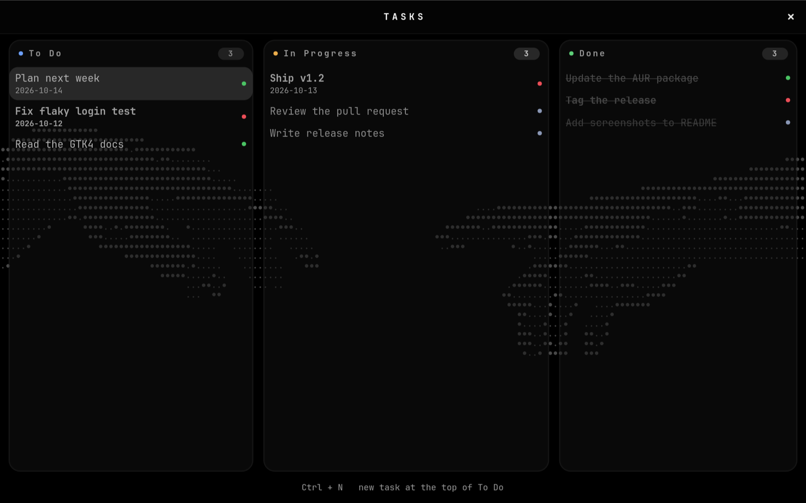
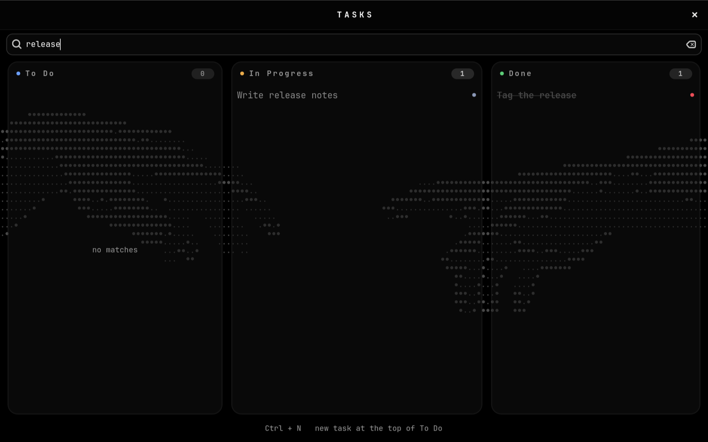
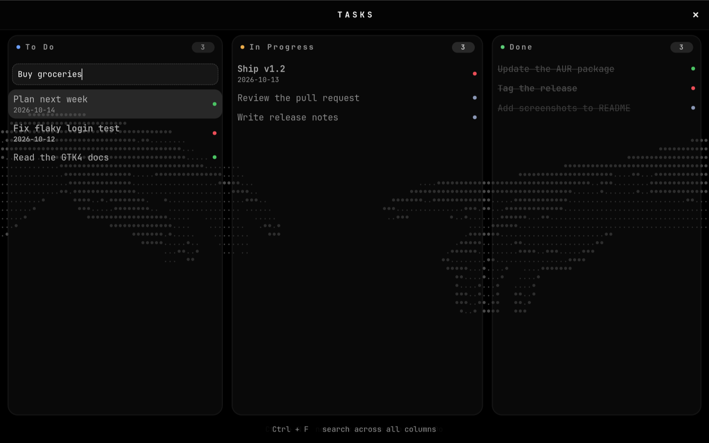

# Tasks

A minimal **3-column kanban board for Omarchy**, built for the keyboard. The GUI
is a small native **GTK4** app in C, so it starts instantly and stays light; a
zero-dependency **CLI/TUI** shares the very same JSON store.



[](LICENSE)

## Install

**Arch / Omarchy — build and install system-wide:**

```bash
git clone https://github.com/dexter-morgan-oss/omarchy-tasks
cd omarchy-tasks
makepkg -si            # builds from the released tarball and installs it
tasks-setup-user       # launcher entry, Omarchy menu row, Super+Shift+T
```

Launch with **Super + Shift + T** (press it again to focus the window), or run
`tasks-gui`. `tasks-setup-user` is **idempotent** — re-run it any time to repair
the launcher entry, menu row and keybinding.

<details>
<summary>Install for just your user (no root)</summary>

```bash
git clone https://github.com/dexter-morgan-oss/omarchy-tasks
cd omarchy-tasks
./install.sh           # builds into ~/.local/bin, then wires up the desktop
```

</details>

> **Requirements:** `gtk4`, `jansson`, `python`; `gcc` and `pkgconf` to build.
> `sudo pacman -S --needed gtk4 jansson gcc pkgconf`
>
> An AUR package is planned — once published, `yay -S tasks-gui` will do the
> whole install in one step.

## Quick start

| Action | How |
|--------|-----|
| **Add** | click empty column space, or `Ctrl+N` |
| **Move / reorder** | drag a card |
| **Complete** | drag into **Done** (drag back out to reopen) |
| **Priority** | click the coloured dot — high · normal · low |
| **Rename** | double-click a card, or right-click → Rename |
| **Due date** | right-click → Due date (`today` / `tomorrow` / `YYYY-MM-DD` / `off`) |
| **Delete** | `Delete`, `Backspace`, `Ctrl+D`, or right-click → Delete |
| **Undo** | `Ctrl+Z` |
| **Search** | `Ctrl+F` |
| **Clear Done** | `Ctrl+Shift+D`, or right-click the Done header |

The add box understands priority markers and a trailing date:

```
!write release notes tomorrow    # ! = high priority
.stock the pantry                # . = low priority
fix flaky test 2026-02-01        # explicit date
```

## CLI

The CLI and GUI read and write the same file, so you can mix them freely:

```bash
tasks list                       # what's on the board
tasks add "buy milk"
tasks add "ship v1" !high tomorrow
tasks done 3                     # complete task id 3
tasks rm 3                       # delete it
tasks clear-done                 # empty the Done column
```

Run `tasks` with no arguments for an interactive TUI. Full walkthrough:
[GUIDE.md](GUIDE.md).

## Features

- **To Do · In Progress · Done**, each column stretching with the window
- **Drag-only completion** — no key moves a task between columns
- **Priority** shown by title colour plus a clickable dot
- **Follows your Omarchy theme** — reads `colors.toml` and recolours live when
  you switch, falling back to a built-in palette
- **Rotating shortcut ticker** along the bottom, so the board stays uncluttered
- **Undo** any Delete / Clear Done with `Ctrl+Z`
- **Due-date notifications** once a day for overdue and due-today tasks
- **One JSON file** — no database, no daemon, no server

<details>
<summary>More screenshots</summary>

Search:



Adding a task with a priority marker and a due date:



</details>

## Configuration

Optional. Create `~/.config/omarchy-tasks/config.ini`:

```ini
font         = JetBrainsMono Nerd Font   # UI font family
font_size    = 13                        # base size in px; the whole scale derives from it
follow_theme = true                      # follow the active Omarchy theme
notify_due   = true                      # once-a-day due notifications
```

`font`/`font_size` default to the Omarchy mono font at 13px; titles, captions
and badges scale from `font_size`, so bump it once to resize the whole board.
`follow_theme` and `notify_due` default to `true`.

## Storage

Everything lives in one file, so backing up is just copying it:

```
~/.local/share/tasks/tasks.json          # $XDG_DATA_HOME/tasks/tasks.json
```

Writes are **atomic** (a temp file is flushed and renamed over the store), so a
crash can never leave a half-written file. If the store is ever unreadable, both
the GUI and CLI move it aside to `tasks.json.corrupt-<stamp>` instead of
overwriting it, then start from an empty board — nothing is lost.

> **Note:** the GUI reads the store once, when it starts. If you edit tasks from
> the CLI while the GUI is open, quit and relaunch the GUI to see the change —
> otherwise the next GUI edit wins.

## Uninstall

```bash
./uninstall.sh            # binaries, launcher entry, icon
./uninstall.sh --purge    # also remove the Super+Shift+T binding
./uninstall.sh --data     # also delete the task store
```

If you installed from the package: `sudo pacman -Rns tasks-gui`.

## Development

```bash
make            # build the GUI
make test       # run the whole suite
make install    # per-user install into ~/.local/bin
```

The suite covers storage, the CLI, CLI/GUI interop, and the GUI itself, which
runs **156 embedded checks** driving its real handlers. GUI tests skip cleanly
on a headless machine.

## Feedback & contributing

This app gets better because people use it and report what breaks. If something
misbehaves — a theme that renders oddly, a drag that won't stick, an install that
fails — please say so.

- **Found a bug?** [Open a bug report](https://github.com/dexter-morgan-oss/omarchy-tasks/issues/new?template=bug_report.yml)
- **Have an idea?** [Request a feature](https://github.com/dexter-morgan-oss/omarchy-tasks/issues/new?template=feature_request.yml) or start a [Discussion](https://github.com/dexter-morgan-oss/omarchy-tasks/discussions)
- **Questions / show-and-tell?** The [Omarchy Discord](https://discord.gg/tXFUdasqhY)
- **Want to send a PR?** See [CONTRIBUTING.md](CONTRIBUTING.md)

Release history and what changed in each version: [CHANGELOG.md](CHANGELOG.md).

## License

[MIT](LICENSE) © P Ragul
